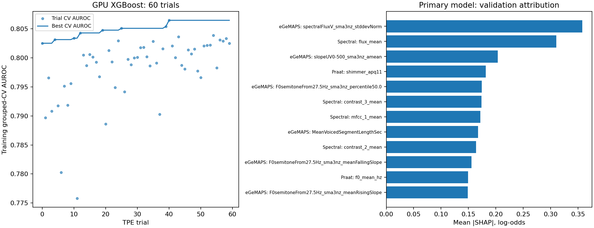

# GPU acoustic-feature XGBoost: implementation and completed results

Implemented and executed on the established184-feature table:22 whole-clip
Praat,22 pitch-tracked-interval Praat,88 eGeMAPSv02 and52 spectral/MFCC features.
Only these allowlisted feature prefixes enter the model. Age, sex, device,
medication, IDs, labels, timestamps, status and QC fields are excluded as inputs.
Recording joins are one-to-one and every acoustic source hash must match the
immutable development snapshot. Missing original initial visits are never
replaced with later recordings.

These are existing full-clip acoustic measurements; they were not recomputed
at the encoder protocol's first10-second cap. This is a standalone acoustic
baseline, not a matched-source-span encoder comparison.

## GPU and search verification

The inherited Conda XGBoost3.4.2 was compiled without CUDA. A pinned official
XGBoost3.4.1 GPU wheel was installed into the private benchmark environment,
leaving the base environment unchanged. `device=cuda`, `tree_method=hist` and
four CPU helper threads are explicit. Each final model checks the actual
booster's device and GPU histogram updater, rejecting silent CPU fallback.
[Official GPU usage](https://xgboost.readthedocs.io/en/stable/gpu/index.html).

The dedicated `scripts/xgboost_python.sh` selects the matching Conda C++ runtime
for this child process. It resolves this HPC's old-system-libstdc++ versus
Conda-SQLite/ICU ABI mismatch without editing system or base-environment files.

Optuna4.6.0 multivariate TPE ran60 trials on one GPU, with12 random startup
trials. Three fixed StratifiedGroupKFold training folds preserve participants
and duplicate components. Both hyperparameter selection and boosting-round
early stopping use training CV only. The search function accepts no validation
features/labels. No outer-validation AUC is used in its objective.

| Parameter | Search range |
|---|---|
| Maximum depth |2–8|
| Minimum child Hessian weight |1–64, log scale|
| Learning rate eta |.005–.2, log scale|
| Row subsampling |.6–1|
| Feature subsampling/tree |.5–1|
| L2 lambda |.001–100, log scale|
| L1 alpha |1e-8–10, log scale|
| Minimum split gain gamma |0–5|
| Histogram bins |128/256/512|
| Boosting rounds |Up to2500; training-CV patience75|

Native missing-value branches are used; no global imputation/scaling/PCA is
fitted for XGBoost. A separate logistic reference fits median imputation,
missingness indicators and scaling inside each training fold. Its C is also
chosen by training CV.

SQLite study state, per-trial histories, sampler state and exact training-data/
configuration identity are checkpointed. Interrupted search resumes completed
trials instead of restarting. File locking prevents concurrent writers. The
resume test reproduces uninterrupted trial parameters and scores exactly on
the deterministic CPU fixture, which also verifies nontrivial learning.

## Completed run

Private root: `$MPOWER_BENCHMARK_ROOT/acoustic_xgboost/20261116T162251Z`.
Smoke job27619782 completed in12s; full job27619783 completed in4m26s, exit0.
The smoke checks GPU routing, missing-value processing, serialization and SHAP
plumbing on a tiny cohort; its stump predictions are not performance estimates.
The full run produced real823-tree models, verified reload predictions, and
verified that GPU-requested SHAP contributions sum to prediction margins.

Forty-five targeted checks passed, including source/schema guards, metadata
exclusion, group isolation, CPU-fallback rejection and exact sampler resume,
plus the existing controlled-adaptation/literature-method checks.

Primary training uses3,397 initial visits, one per participant. Validation uses
the same729 initial assessments as earlier comparisons (146PD/583controls).
The final test remains sealed.

The best training-CV trial was40, with AUROC.80645 and fold SD.00347. It chose:

```text
823 trees; max_depth=4; eta=0.044286
min_child_weight=1.460114; subsample=0.751323
colsample_bytree=0.900528; lambda=4.247342
alpha=8.8028e-7; gamma=0.689102; max_bin=128
```

## Validation results

| Pipeline | AUROC | Average precision | Sensitivity at90.05% specificity |
|---|---:|---:|---:|
| Tuned XGBoost, initial visits |.8169|.5674|52.1%|
| Logistic reference, initial visits |.8210|.5625|52.7%|
| XGBoost, equal-person repeated visits |**.8380**|**.6121**|**56.2%**|

The repeated-visit model uses43,702 training recordings, weighted so each
participant contributes total weight1 (sum3397). It reuses the primary model's
selected tree parameters and823 rounds; it was not separately retuned or
selected using validation. Its comparison with initial-visit LR therefore
changes both algorithm and training exposure.

Paired component-bootstrap2000-replicate AUROC differences:

- Primary XGBoost minus LR: -.0041,95% interval[-.0368,.0282].
- Repeated-visit XGBoost minus initial-visit XGBoost: +.0211,[-.0027,.0439].
- Repeated-visit XGBoost minus initial-visit LR: +.0171,[-.0109,.0461].

The initial-visit tree model does not show a gain over LR. Repeated visits give
a higher point estimate, with uncertainty still spanning no improvement.
These intervals are exploratory, conditional on fitted/selected models, and
do not account for HPO/model selection or training-seed variability. Thresholds
are selected on validation and are not prospectively verified operating points.

Fixed-hyperparameter diagnostic ablations (not separately tuned family optima):

| Input | AUROC |
|---|---:|
| Praat44 |.7141|
| eGeMAPS88 |.7972|
| Spectral/MFCC52 |.7664|
| Missingness indicators only |.5180|

The missingness-only scores have ties and achieve98.8% specificity under the
conservative threshold rule; its sensitivity is not an exact90%-specificity
comparison. Its near-chance AUROC is a diagnostic check, not proof that every
technical confound is absent.

## Interpretation and artifacts

Largest mean absolute SHAP contributions in the primary model include voiced
spectral-flux variability, mean spectral flux, unvoiced spectral slope, shimmer
APQ11, F0 median, spectral contrast and MFCC1. These explain this fitted model;
they do not establish causal PD biomarkers and may encode age/device effects.



Aggregate exports: [all metrics](results/acoustic_xgboost/metrics.csv),
[best parameters and paired intervals](results/acoustic_xgboost/summary.json),
[all search trials](results/acoustic_xgboost/search_trials.csv), and
[SHAP/gain ranking](results/acoustic_xgboost/feature_importance.csv).
Models (`model.ubj`), full tree structures, study databases and individual
predictions remain private under the run root. No additional model is selected
or retuned from these validation diagnostics.

## Re-run

Install `requirements-xgboost.txt`; set `MPOWER_BENCHMARK_ROOT`,
`MPOWER_BENCHMARK_PYTHON`, `MPOWER_OUTPUT_ROOT` and `MPOWER_ADAPT_SNAPSHOT`.

```bash
python scripts/submit_acoustic_xgboost.py
# HPC checks using the dedicated runtime wrapper:
bash scripts/xgboost_python.sh -m pytest -q tests/test_acoustic_xgboost.py
```

The submitter snapshots code/configs privately and gates the full search on
successful GPU smoke completion. New runs use new directories; interrupted
runs can resume with the same immutable code, data and search configuration.
