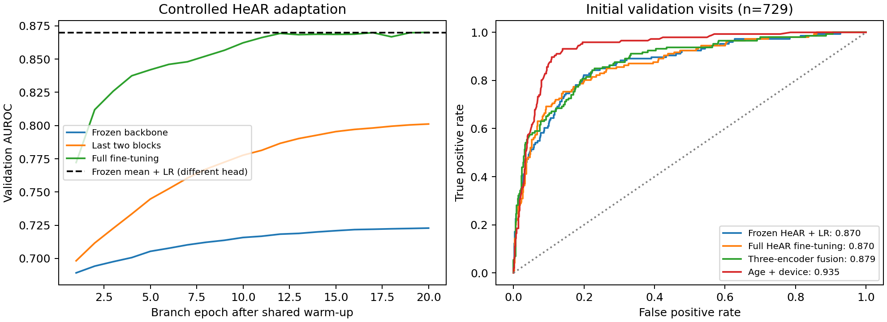

# Completed HeAR development results

All seven final HeAR jobs completed successfully. This is a validation analysis,
not a final-test evaluation. No test labels were opened and no new training jobs
were submitted during this analysis. Machine-readable results and all metrics
are in [the summary](results/hear_completed/summary.json) and
[the metrics table](results/hear_completed/metrics.csv).

## Cohort and execution

- Frozen extraction completed for all 53,122 development recordings; the encoder
  fingerprint stayed unchanged.
- Training: 3,397 participants. Validation: 729 canonical initial assessments,
  including 146 PD and 583 controls.
- Frozen, last-two and full adaptation branches used identical best warm-up
  backbone/head initialization. Heads changed in every arm, adapted backbones
  changed, frozen parameters stayed unchanged, and adapted epochs had nonzero
  backbone gradients.
- HeAR uses the pinned official 303.2M-parameter checkpoint, its native 512D
  pooler, independent official preprocessing per two-second window, float32
  computation and no TF32/AMP. The final real GPU smoke and artifact audit passed.
- Jobs 27612307–27612313 all exited 0. Frozen extraction/heads took 1h00m14s,
  warm-up 42m36s, frozen branch 1h21m28s, last-two 1h18m23s, full 2h25m50s,
  and downstream classifiers 27m55s. These are job durations, not a sum of
  sequential elapsed time, since some branches overlap.

## HeAR frozen probes and fine-tuning

All rows evaluate the same 729 participants. Sensitivity uses thresholds selected
on this validation cohort to achieve 90.05% specificity (525/583 controls);
it is an exploratory operating point, not a prospectively verified threshold.

| Method | AUROC | Average precision | Sensitivity at ~90% specificity |
|---|---:|---:|---:|
| Frozen window mean + standardized logistic regression | .8700 | .6858 | 62.3% |
| Frozen mean + MLP | .8546 | .6326 | 61.6% |
| Frozen mean+SD + logistic regression | .8583 | .6897 | 62.3% |
| Frozen mean+SD + MLP | .8576 | .6659 | 63.0% |
| Frozen backbone + native LayerNorm/linear head | .7229 | .3994 | 33.6% |
| Last two blocks fine-tuned + same native head | .8012 | .5271 | 45.2% |
| Full fine-tuning + same native head | .8701 | .6702 | 69.2% |

The first four probes use weighted training visits and train-only grouped CV for
logistic regularization; MLP epochs are selected on validation. Adaptation uses
one sampled visit/person/epoch, a native LayerNorm+linear head, AdamW, 10 warm-up
epochs and 20 branch epochs. Thus the three native-head rows are the matched
unfreezing comparison. The standardized logistic probe is a different, stronger
head pipeline and is essential when judging practical benefit.

Full fine-tuning improves AUROC by .1473 over its matched frozen neural control
(paired component-bootstrap 95% interval [.1075,.1875]). Last-two improves by
.0783 [.0559,.1016]. These successful parameter updates are not failed runs.

However, full fine-tuning differs from the strong frozen logistic probe by only
.00013, with an interval of [-.0187,.0199]. This experiment does not establish
an AUROC gain over the practical frozen baseline. Full tuning has higher
validation sensitivity at the chosen specificity: 101/146 PD participants versus
91/146 for frozen logistic regression, with 58 false positives in each. This
operating-point difference needs confirmation after threshold locking.

At a conventional .5 probability cutoff, full fine-tuning accuracy is 86.28%,
and frozen logistic accuracy is 86.42%. These accuracy values are distinct from
AUROC and are affected by the validation class imbalance.

## Classifiers and fusion on initial training visits

This panel trains on one canonical initial visit per training participant, so
PCA gives each participant equal influence. It uses participant/component-grouped
training CV for LR, PCA+LR and LinearSVC selection. Calibration and stacking use
training OOF predictions only. It is a separate training design from the weighted
all-visit probes above. All rows still evaluate the same validation participants.

| Selected pipeline | AUROC | Average precision |
|---|---:|---:|
| Whisper Small: LR, C=.01 | .8664 | .6702 |
| WavLM Large: PCA128 + LR, C=.01 | .8716 | .6741 |
| HeAR: LR, C=.01 | .8570 | .6418 |
| Whisper + WavLM: PCA128 + LR | .8759 | .7002 |
| Whisper + WavLM + HeAR: PCA128 + LR | .8794 | .7007 |
| Three-encoder equal probability average | .8697 | .6737 |
| Three-encoder OOF stacking | .8711 | .6751 |
| Age + device | .9352 | .7509 |
| Age + device + Whisper | .9357 | .8085 |
| Age + device + three-encoder early fusion | .9142 | .7962 |

Adding HeAR to two-encoder early fusion changes AUROC by +.00354
[-.00546,.01242]. Three-encoder fusion exceeds the strongest single encoder,
WavLM, by +.00777 [-.00732,.02402]. Both intervals include zero; the observed
gains are small and uncertain. PCA+LR won the fusion comparison; the selected
heads were all logistic variants, rather than LinearSVC.

Age/device remains the strongest signal in pooled AUROC. Adding Whisper barely
changes AUROC (+.00051, interval [-.01643,.01529]), but raises average precision
from .7509 to .8085 and improves Brier score from .07675 to .07382. Log loss is
slightly worse (.24925 versus .24876), so this is not an improvement on every
metric. Adding the three-encoder fusion decreases AUROC by .02102
[-.04464,.00151]. More concatenated features did not reliably improve this
demographic baseline. Joint dimensionality reduction/regularization may contribute;
these results do not isolate its cause or prove that audio has no incremental value.

## What the learning curves imply

The shared warm-up ends at AUROC .6866. The frozen native head and last-two
branch continue rising slowly and select their last allowed epoch. Full tuning
reaches about .87 by branch epoch 12 and largely plateaus; its selected epoch is
20. A longer full-tuning run is not automatically the highest-value next step.

The weak native frozen head is a major diagnostic finding. Its per-record
LayerNorm preprocessing and AdamW training differ from the strong standardized
logistic probe. The evidence suggests investigating head conditioning and
optimization; it does not isolate low learning rate, normalization, or limited
training budget as the cause. A large improvement over this weak neural control
should not be presented as beating strong frozen representations.

## Corrected AST comparison

The earlier corrected AST jobs also completed. With shared best warm-up and
matched head schedules, frozen backbone AUROC is .8715, last-two is .8671,
and full tuning is .8647. These branches updated the intended weights and passed
frozen-parameter audits. Corrected AST tuning still did not beat its frozen
control in this seed/development split. The summary includes paired bootstrap
comparisons: full minus frozen -.00679 [-.01186,-.00178], last-two minus frozen
-.00435 [-.00779,-.00101]. These conditional development intervals do not account
for seed variability or repeated validation selection.

## Focused next steps

1. Extract the full-tuned HeAR representation and fit the same standardized
   logistic probes used for the pretrained representation. This separates
   representation quality from native-head conditioning without another
   backbone-training sweep.
2. Diagnose the frozen LayerNorm/linear head using cached features and a small
   training-only learning-rate/convergence comparison. Establish a strong matched
   frozen neural control before testing extra learning objectives.
3. Confirm a narrow shortlist across three seeds. Preserve the current initial-
   visit validation endpoint, test seal and participant/component split isolation.
4. Evaluate age-overlap/sex/device sensitivity and audio's incremental value with
   calibration and a locked operating point. Do not equate pooled age-driven
   performance with disease-specific acoustic evidence.
5. Then test the pre-specified BCE/SupCon/acoustic-auxiliary arms on one selected
   encoder, using the already documented participant-aware objectives and controls.

All intervals use 2,000 paired duplicate-component bootstrap replicates. They
are exploratory, conditional on fitted models/selected checkpoints, and do not
account for extensive validation selection or training-seed variability. No
independent final-test improvement is claimed.
